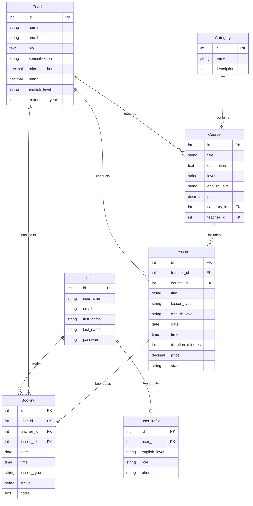
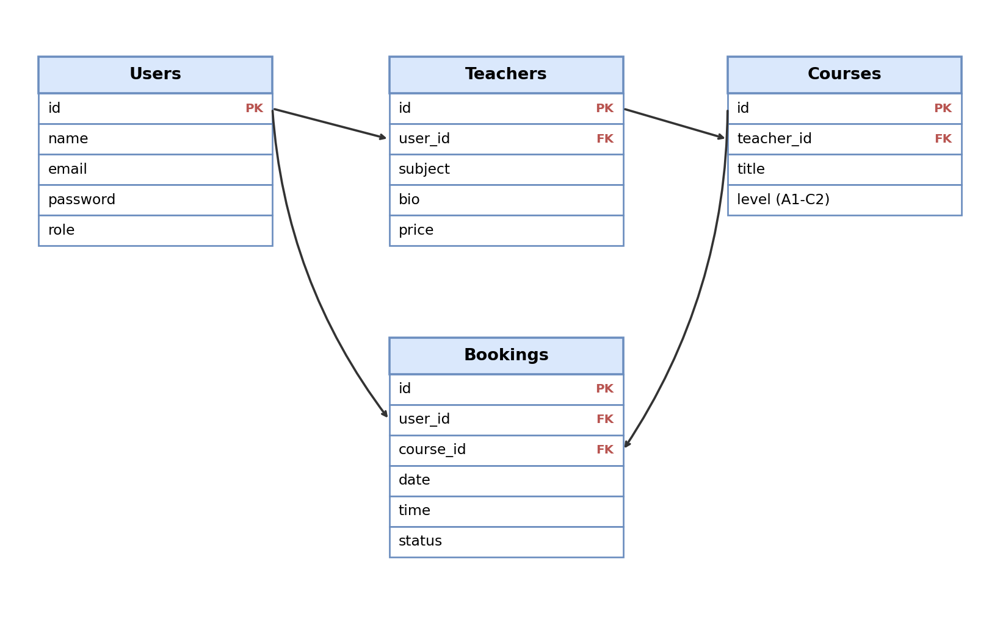

# English Courses REST API 🇬🇧

Повнофункціональний RESTful API бекенд для платформи курсів англійської мови та бронювання онлайн-занять з репетиторами. Проєкт розроблено на базі **Django 6** та **Django REST Framework (DRF)** з використанням **APIView**, ORM-запитів, системи автентифікації на базі **JWT (JSON Web Tokens)** за допомогою `djangorestframework_simplejwt`, розмежуванням прав доступу (Permissions) та єдиним форматом обробки помилок.

---

## 📑 Зміст
1. [Архітектура та можливості](#-архітектура-та-можливості)
2. [Встановлення та запуск проєкту](#-встановлення-та-запуск-проєкту)
3. [Тестування API](#-тестування-api)
4. [Автентифікація через JWT та життєвий цикл токенів](#-автентифікація-через-jwt-та-життєвий-цикл-токенів)
5. [Матриця прав доступу (Permissions)](#-матриця-прав-доступу-permissions)
6. [Єдиний формат обробки помилок (Error Handling)](#-єдиний-формат-обробки-помилок-error-handling)
7. [Детальний опис ендпоінтів API](#-детальний-опис-ендпоінтів-api)
   - [1. Автентифікація та Користувачі (Users)](#1-автентифікація-та-користувачі-users)
   - [2. Викладачі та Профілі (Teachers)](#2-викладачі-та-профілі-teachers)
   - [3. Заняття (Lessons)](#3-заняття-lessons)
   - [4. Бронювання (Bookings)](#4-бронювання-bookings)
   - [5. Курси (Courses)](#5-курси-courses)
   - [6. Категорії (Categories)](#6-категорії-categories)
8. [Робота з Postman-колекцією (v2.1)](#-робота-з-postman-колекцією-v21)
9. [Схема бази даних](#-схема-бази-даних)

---

## 🏛 Архітектура та можливості

- **Django App `courses`**: керування категоріями, репетиторами, навчальними курсами, окремими уроками та записами студентів на заняття.
- **Django App `users`**: реєстрація студентів, авторизація через JWT, профіль користувача (`UserProfile`), збереження рівня англійської (`english_level`), безпечне хешування паролів та механізм відкликання токенів (Blacklist).
- **Вимоги до архітектури**:
  - Усі представлення успадковані від **`rest_framework.views.APIView`**.
  - Усі операції з базою даних здійснюються виключно через **Django ORM**.
  - Налаштовано CORS (`django-cors-headers`) для підключення фронтенду на будь-якому порту.
  - Єдиний уніфікований JSON-формат для всіх типів помилок (400, 401, 403, 404, 409).

---

## 🚀 Встановлення та запуск проєкту

### 1. Клонування репозиторію та створення віртуального середовища
```bash
git clone <repository-url>
cd eng-courses-api

# Створення віртуального середовища
python -m venv venv

# Активація віртуального середовища
# Windows:
.\venv\Scripts\activate
# Linux/macOS:
source venv/bin/activate
```

### 2. Встановлення залежностей
```bash
pip install -r requirements.txt
```

### 3. Застосування міграцій
```bash
python manage.py migrate
```

### 4. Наповнення бази даних тестовими даними (Seeding)
Для швидкого старту та тестування створено команду:
```bash
python manage.py seed_data
```
Команда створить:
- Обліковий запис адміністратора: `admin` / `Admin1234!`
- Обліковий запис студента: `student` / `Student1234!`
- Базові категорії (Exam Prep, Speaking Clubs, Business English, General English)
- Викладачів із профілями, рівнями володіння (`english_level`: C1, C2, Native), досвідом та ставками
- Навчальні курси та розклад занять (Speaking Club, Individual, тощо)

### 5. Запуск сервера розробки
```bash
python manage.py runserver 127.0.0.1:8000
```
API буде доступне за адресою: `http://127.0.0.1:8000/api/`

---

## 🧪 Тестування API

Проєкт покритий повним набором автоматизованих тестів (`courses/tests.py`, `users/tests.py`), що перевіряють:
- Валідацію реєстрації та хешування паролів.
- JWT авторизацію та захист маршрутів.
- Фільтрацію занять викладача за ID та `lesson_type`.
- Повернення статусів `400 Bad Request`, `401 Unauthorized`, `403 Forbidden`, `404 Not Found` та `409 Conflict`.

Запуск тестів:
```bash
python manage.py test
```

---

## 🔐 Автентифікація через JWT та життєвий цикл токенів

Для авторизованих запитів використовується протокол **JSON Web Token (JWT)**.

### Хедер авторизації:
Усі захищені ендпоінти вимагають передачі заголовка HTTP:
```http
Authorization: Bearer <access_token>
```

### Життєвий цикл токенів (Access & Refresh):
1. **Отримання токенів**:
   - При реєстрації (`POST /api/users/register/`) або логіні (`POST /api/users/login/`) клієнт отримує пару токенів:
     - `access`: дійсний протягом **60 хвилин**; використовується для автентифікації запитів.
     - `refresh`: дійсний протягом **7 днів**; використовується для продовження сесії.
2. **Оновлення (Refresh)**:
   - Коли `access` токен закінчується і сервер повертає `401 Unauthorized`, фронтенд викликає ендпоінт:
     `POST /api/users/token/refresh/` з тілом `{"refresh": "<refresh_token>"}`.
   - Сервер валідує токен і повертає новий `access` токен (і оновлений `refresh` токен завдяки увімкненій ротації токенів).
   - Користувачеві **не потрібно повторно вводити логін і пароль**.
3. **Вихід (Logout)**:
   - При виході клієнт викликає `POST /api/users/logout/` із `refresh` токеном.
   - Сервер додає токен до чорного списку (`token_blacklist`), а клієнт очищує локальне сховище.

---

## 🛡 Матриця прав доступу (Permissions)

| Ендпоінт / Ресурс | Метод | Анонімний користувач | Авторизований студент | Адміністратор / Staff |
| :--- | :--- | :---: | :---: | :---: |
| `/api/users/register/` | POST | ✅ Дозволено | ❌ (Вже у системі) | ✅ Дозволено |
| `/api/users/login/` | POST | ✅ Дозволено | ❌ (Вже у системі) | ✅ Дозволено |
| `/api/users/me/` | GET, PUT, PATCH | 🔒 401 Unauthorized | ✅ Свій профіль | ✅ Свій профіль |
| `/api/users/me/bookings/` | GET | 🔒 401 Unauthorized | ✅ Свої бронювання | ✅ Свої бронювання |
| `/api/teachers/` | GET | ✅ Перегляд | ✅ Перегляд | ✅ Перегляд |
| `/api/teachers/` | POST | 🔒 401 Unauthorized | ⛔ 403 Forbidden | ✅ Створення |
| `/api/teachers/{id}/` | GET | ✅ Детальний профіль | ✅ Детальний профіль | ✅ Детальний профіль |
| `/api/teachers/{id}/` | PUT, PATCH, DELETE | 🔒 401 Unauthorized | ⛔ 403 Forbidden | ✅ Редагування/Видалення |
| `/api/teachers/{id}/lessons/` | GET | ✅ Перегляд занять | ✅ Перегляд занять | ✅ Перегляд занять |
| `/api/courses/` | GET | ✅ Перегляд | ✅ Перегляд | ✅ Перегляд |
| `/api/courses/` | POST, PUT, DELETE | 🔒 401 Unauthorized | ⛔ 403 Forbidden | ✅ Повний доступ |
| `/api/lessons/` | GET | ✅ Перегляд | ✅ Перегляд | ✅ Перегляд |
| `/api/lessons/` | POST, PUT, DELETE | 🔒 401 Unauthorized | ⛔ 403 Forbidden | ✅ Повний доступ |
| `/api/bookings/` | POST | 🔒 401 Unauthorized | ✅ Забронювати урок | ✅ Забронювати урок |
| `/api/bookings/{id}/` | DELETE | 🔒 401 Unauthorized | ✅ Скасувати свій | ✅ Скасувати будь-який |

---

## ⚠️ Єдиний формат обробки помилок (Error Handling)

Усі помилки на всіх ендпоінтах повертаються в **уніфікованому форматі JSON**:

```json
{
  "error": "Текстовий опис помилки зрозумілою мовою",
  "status_code": 400,
  "details": {
    "поле": ["Деталізоване повідомлення про помилку"]
  }
}
```

### Стандартні статуси помилок:
- **`400 Bad Request`**: Помилка валідації вхідних даних (невірний email, не співпадають паролі, відсутні обов'язкові поля).
- **`401 Unauthorized`**: Відсутній або недійсний токен авторизації.
- **`403 Forbidden`**: Недостатньо прав для виконання дії (наприклад, студент намагається видалити викладача).
- **`404 Not Found`**: Запитуваний ресурс (викладач, курс, бронювання) не існує.
- **`409 Conflict`**: Конфлікт цілісності даних (наприклад, спроба видалити викладача, за яким закріплені діючі курси або заняття).

---

## 📖 Детальний опис ендпоінтів API

### 1. Автентифікація та Користувачі (Users)

#### 1.1 Реєстрація нового користувача
- **Метод**: `POST`
- **URL**: `/api/users/register/` (або `/api/auth/register/`)
- **Доступ**: Публічний (AllowAny)
- **Заголовки**: `Content-Type: application/json`
- **Тіло запиту (Request Body)**:
```json
{
  "username": "vlada_student",
  "email": "vlada@gmail.com",
  "first_name": "Владислава",
  "last_name": "Штомпіль",
  "password": "Password123!",
  "password_confirm": "Password123!",
  "english_level": "B2",
  "role": "student"
}
```
*Валідація:*
- `username` (обов'язкове, макс. 150 символів, унікальне, літери/цифри/`_.-`);
- `email` (обов'язкове, макс. 254 символи, унікальне, коректний формат);
- `first_name`, `last_name` (необов'язкові, макс. 150 символів);
- `password` (обов'язкове, мін. 8 символів, літери + цифри);
- `password_confirm` (обов'язкове, має збігатися з `password`);
- `english_level` (необов'язкове, за замовчуванням "B2", вибір: A1, A2, B1, B2, C1, C2).
- Пароль зберігається в базі виключно в захешованому вигляді (`PBKDF2 SHA256`).

- **Успішна відповідь (`201 Created`)**:
```json
{
  "message": "Користувача успішно зареєстровано.",
  "user": {
    "id": 1,
    "username": "vlada_student",
    "email": "vlada@gmail.com",
    "first_name": "Владислава",
    "last_name": "Штомпіль",
    "english_level": "B2",
    "role": "student",
    "phone": null,
    "is_staff": false,
    "date_joined": "2026-11-10T16:00:00Z"
  },
  "tokens": {
    "access": "eyJhbGciOiJIUzI1NiIsInR5cCI6IkpXVCJ9...",
    "refresh": "eyJhbGciOiJIUzI1NiIsInR5cCI6IkpXVCJ9..."
  }
}
```
- **Помилка валідації (`400 Bad Request`)**:
```json
{
  "error": "Помилка валідації при реєстрації користувача.",
  "status_code": 400,
  "details": {
    "email": ["Введіть коректну адресу електронної пошти (наприклад, name@example.com)."],
    "password_confirm": ["Паролі не збігаються."]
  }
}
```

---

#### 1.2 Авторизація (Вхід у систему)
- **Метод**: `POST`
- **URL**: `/api/users/login/` (або `/api/auth/login/`)
- **Доступ**: Публічний
- **Тіло запиту**:
```json
{
  "username": "vlada_student",
  "password": "Password123!"
}
```
*(Можна також передавати `"email": "vlada@gmail.com"` замість `username`)*

- **Успішна відповідь (`200 OK`)**:
```json
{
  "message": "Вхід успішно виконано.",
  "access": "eyJhbGciOiJIUzI1NiIsInR5cCI6IkpXVCJ9...",
  "refresh": "eyJhbGciOiJIUzI1NiIsInR5cCI6IkpXVCJ9...",
  "token": "eyJhbGciOiJIUzI1NiIsInR5cCI6IkpXVCJ9...",
  "user": {
    "id": 1,
    "username": "vlada_student",
    "email": "vlada@gmail.com",
    "first_name": "Владислава",
    "last_name": "Штомпіль",
    "english_level": "B2",
    "role": "student",
    "is_staff": false
  }
}
```
- **Помилка (`401 Unauthorized`)**:
```json
{
  "error": "Невірне ім'я користувача (email) або пароль.",
  "status_code": 401
}
```

---

#### 1.3 Оновлення access токена (Refresh Token)
- **Метод**: `POST`
- **URL**: `/api/users/token/refresh/` (або `/api/users/refresh/`)
- **Доступ**: Публічний
- **Тіло запиту**:
```json
{
  "refresh": "eyJhbGciOiJIUzI1NiIsInR5cCI6IkpXVCJ9..."
}
```
- **Успішна відповідь (`200 OK`)**:
```json
{
  "access": "eyJhbGciOiJIUzI1NiIsInR5cCI6IkpXVCJ9.new_access...",
  "refresh": "eyJhbGciOiJIUzI1NiIsInR5cCI6IkpXVCJ9.new_refresh..."
}
```
- **Помилка (`401 Unauthorized`)**:
```json
{
  "error": "Недійсний або прострочений refresh токен.",
  "status_code": 401,
  "details": "Token is invalid or expired"
}
```

---

#### 1.4 Отримання та редагування свого профілю (Me)
- **Метод**: `GET` / `PUT` / `PATCH`
- **URL**: `/api/users/me/`
- **Доступ**: Лише авторизовані користувачі (`IsAuthenticated`)
- **Заголовки**: `Authorization: Bearer <access_token>`
- **Успішна відповідь `GET` (`200 OK`)**:
```json
{
  "id": 1,
  "username": "vlada_student",
  "email": "vlada@gmail.com",
  "first_name": "Владислава",
  "last_name": "Штомпіль",
  "english_level": "B2",
  "role": "student",
  "phone": null,
  "is_staff": false,
  "date_joined": "2026-11-10T16:00:00Z"
}
```
- **Тіло запиту `PUT` / `PATCH`**:
```json
{
  "first_name": "Влада",
  "last_name": "Штомпіль",
  "english_level": "C1"
}
```

---

#### 1.5 Вихід із системи (Logout)
- **Метод**: `POST`
- **URL**: `/api/users/logout/`
- **Доступ**: Публічний / Авторизований
- **Тіло запиту**:
```json
{
  "refresh": "eyJhbGciOiJIUzI1NiIsInR5cCI6IkpXVCJ9..."
}
```
- **Успішна відповідь (`200 OK`)**:
```json
{
  "message": "Успішний вихід із системи. Токени видалено.",
  "status_code": 200
}
```

---

### 2. Викладачі та Профілі (Teachers)

#### 2.1 Отримання списку викладачів із фільтрацією
- **Метод**: `GET`
- **URL**: `/api/teachers/`
- **Query параметри**:
  - `specialization` (наприклад: `?specialization=IELTS`) — фільтр за напрямком.
  - `english_level` або `level` (наприклад: `?english_level=C2`) — фільтр за рівнем англійської.
  - `search` (наприклад: `?search=Lily`) — пошук за іменем чи біографією.
- **Успішна відповідь (`200 OK`)**:
```json
[
  {
    "id": 1,
    "name": "Lily Snape",
    "email": "lily.snape@engcourses.com",
    "bio": "Сертифікований викладач CELTA з 5-річним досвідом підготовки студентів до IELTS.",
    "specialization": "IELTS Prep",
    "price_per_hour": "450.00",
    "rating": "4.95",
    "english_level": "C2",
    "experience_years": 5,
    "courses_count": 1
  }
]
```

---

#### 2.2 Детальна інформація профілю викладача
- **Метод**: `GET`
- **URL**: `/api/teachers/{id}/` або `/api/teachers/{id}/profile/`
- **Опис**: Повертає детальний профіль викладача разом зі списком його курсів та доступних занять (`lessons`).
- **Успішна відповідь (`200 OK`)**:
```json
{
  "id": 1,
  "name": "Lily Snape",
  "email": "lily.snape@engcourses.com",
  "bio": "Сертифікований викладач CELTA з 5-річним досвідом підготовки студентів до IELTS.",
  "specialization": "IELTS Prep",
  "price_per_hour": "450.00",
  "rating": "4.95",
  "english_level": "C2",
  "experience_years": 5,
  "courses_count": 1,
  "lessons_count": 2,
  "courses": [
    {
      "id": 1,
      "title": "IELTS Academic Masterclass",
      "level": "B2",
      "english_level": "B2",
      "price": "4200.00"
    }
  ],
  "lessons": [
    {
      "id": 1,
      "teacher": 1,
      "teacher_name": "Lily Snape",
      "course": 1,
      "course_title": "IELTS Academic Masterclass",
      "title": "IELTS Speaking Part 2 & 3: Deep Dive",
      "lesson_type": "Speaking Club",
      "english_level": "B2",
      "date": "2026-11-25",
      "time": "17:00:00",
      "duration_minutes": 60,
      "price": "350.00",
      "status": "scheduled",
      "description": "Симуляція реального усного інтерв'ю IELTS."
    }
  ]
}
```
- **Помилка (`404 Not Found`)**:
```json
{
  "error": "Викладача не знайдено",
  "status_code": 404
}
```

---

#### 2.3 Специфічний ендпоінт: заняття викладача за ID та типом уроку
- **Метод**: `GET`
- **URL**: `/api/teachers/{teacher_id}/lessons/?lesson_type=Speaking Club`
- **Опис**: Повертає список занять конкретного викладача з можливістю фільтрації за `lesson_type` (наприклад, Speaking Club, Individual, Grammar, тощо) та `english_level`.
- **Query параметри**:
  - `lesson_type` (обов'язково/опціонально): назва або підрядок типу уроку.
  - `english_level`: фільтр за рівнем (наприклад: B2).
- **Успішна відповідь (`200 OK`)**:
```json
{
  "teacher_id": 1,
  "teacher_name": "Lily Snape",
  "count": 1,
  "lessons": [
    {
      "id": 1,
      "teacher": 1,
      "teacher_name": "Lily Snape",
      "course": 1,
      "course_title": "IELTS Academic Masterclass",
      "title": "IELTS Speaking Part 2 & 3: Deep Dive",
      "lesson_type": "Speaking Club",
      "english_level": "B2",
      "date": "2026-11-25",
      "time": "17:00:00",
      "duration_minutes": 60,
      "price": "350.00",
      "status": "scheduled",
      "description": "Симуляція реального усного інтерв'ю IELTS."
    }
  ]
}
```

---

#### 2.4 Створення викладача
- **Метод**: `POST`
- **URL**: `/api/teachers/`
- **Доступ**: Авторизований користувач або адміністратор
- **Тіло запиту**:
```json
{
  "name": "Sarah Connor",
  "email": "sarah.connor@example.com",
  "bio": "Expert in Cambridge Exams (FCE, CAE)",
  "specialization": "Cambridge CAE",
  "price_per_hour": 500.00,
  "rating": 5.0,
  "english_level": "C2",
  "experience_years": 6
}
```
- **Успішна відповідь (`201 Created`)**

---

#### 2.5 Видалення викладача (із перевіркою конфліктів)
- **Метод**: `DELETE`
- **URL**: `/api/teachers/{id}/`
- **Доступ**: Авторизований користувач або адміністратор
- **Успішна відповідь (`204 No Content`)**: статус 204.
- **Помилка конфлікту (`409 Conflict`)**: Якщо за викладачем закріплені курси чи заняття:
```json
{
  "error": "Неможливо видалити викладача, оскільки за ним закріплено курсів: 1, занять: 2.",
  "status_code": 409,
  "details": {
    "courses_count": 1,
    "lessons_count": 2
  }
}
```

---

### 3. Заняття (Lessons)

- `GET /api/lessons/` — Список усіх занять із фільтрами: `?teacher_id=1&lesson_type=Speaking Club&english_level=B2`.
- `POST /api/lessons/` — Створення нового заняття (потрібна авторизація).
- `GET /api/lessons/{id}/` — Деталі заняття.
- `PUT /api/lessons/{id}/` — Оновлення заняття.
- `DELETE /api/lessons/{id}/` — Видалення заняття.

---

### 4. Бронювання (Bookings)

#### 4.1 Запис на урок (Створення бронювання)
- **Метод**: `POST`
- **URL**: `/api/bookings/`
- **Доступ**: Лише авторизовані користувачі (`IsAuthenticated`)
- **Заголовки**: `Authorization: Bearer <access_token>`
- **Тіло запиту**:
```json
{
  "teacher_id": 1,
  "date": "2026-11-25",
  "time": "17:00",
  "lesson_type": "Speaking Club",
  "lesson_id": 1,
  "notes": "Хочу звернути особливу увагу на вимову та флуентність."
}
```
- **Успішна відповідь (`201 Created`)**:
```json
{
  "id": 1,
  "booking_id": 1,
  "teacher_id": 1,
  "teacher_name": "Lily Snape",
  "date": "2026-11-25",
  "time": "17:00",
  "lesson_type": "Speaking Club",
  "status": "confirmed",
  "message": "Заняття успішно заброньовано"
}
```
- **Помилка (`401 Unauthorized`)**: Коли запит надіслано без токена.
- **Помилка (`404 Not Found`)**: Якщо викладача з таким ID не існує.

---

#### 4.2 Перегляд моїх занять (My Bookings)
- **Метод**: `GET`
- **URL**: `/api/users/me/bookings/`
- **Доступ**: Лише авторизовані користувачі (`IsAuthenticated`)
- **Заголовки**: `Authorization: Bearer <access_token>`
- **Успішна відповідь (`200 OK`)**:
```json
[
  {
    "booking_id": 1,
    "id": 1,
    "teacher_id": 1,
    "teacher_name": "Lily Snape",
    "date": "2026-11-25",
    "time": "17:00:00",
    "lesson_type": "Speaking Club",
    "status": "confirmed",
    "notes": "Хочу звернути особливу увагу на вимову та флуентність.",
    "created_at": "2026-11-10T16:15:00Z"
  }
]
```

---

#### 4.3 Скасування бронювання
- **Метод**: `DELETE`
- **URL**: `/api/bookings/{id}/`
- **Доступ**: Власник бронювання або адміністратор
- **Успішна відповідь (`200 OK`)**:
```json
{
  "message": "Бронювання успішно скасовано.",
  "booking_id": 1,
  "status": "cancelled"
}
```

---

### 5. Курси (Courses)

- `GET /api/courses/` — Отримання списку курсів (підтримує фільтри `?english_level=B2`, `?category_id=1`, `?teacher_id=1`, `?search=`).
- `POST /api/courses/` — Створення курсу (потрібна авторизація):
```json
{
  "title": "Business English for IT Specialists",
  "description": "Learn professional tech vocabulary and presentation skills",
  "level": "B2",
  "english_level": "B2",
  "price": 3500.00,
  "category": 1,
  "teacher": 1
}
```
- `GET /api/courses/{id}/` — Деталі конкретного курсу.
- `PUT /api/courses/{id}/` — Оновлення курсу.
- `DELETE /api/courses/{id}/` — Видалення курсу (`204 No Content`).

---

### 6. Категорії (Categories)

- `GET /api/categories/` — Список категорій.
- `POST /api/categories/` — Створення категорії (потрібна авторизація):
```json
{
  "name": "General English",
  "description": "Курси загальної англійської для всіх рівнів"
}
```
- `GET /api/categories/{id}/` — Деталі категорії.
- `DELETE /api/categories/{id}/` — Видалення категорії. Якщо до категорії прив'язані курси, повертається `409 Conflict`.

---

## 📮 Робота з Postman-колекцією (v2.1)

Файли колекції знаходяться в директорії `postman/`:
- `postman/english_courses_api.postman_collection.json` — Повна колекція запитів формату v2.1.
- `postman/english_courses_local.postman_environment.json` — Змінні середовища (`{{base_url}}`, `{{access_token}}`, тощо).

### Як імпортувати та використовувати:
1. Відкрийте Postman -> Натисніть **Import** -> Оберіть обидва файли з папки `postman/`.
2. Оберіть середовище **"English Courses API - Local Environment"**.
3. Змінна `{{base_url}}` встановлена на `http://127.0.0.1:8000`.
4. Виконайте запит **"Login User"**: у ньому налаштовано автоматичний `Tests`-скрипт, який зберігає отримані `access` та `refresh` токени в змінні оточення `{{access_token}}` та `{{refresh_token}}`.
5. Усі захищені запити автоматично підставляють заголовок `Authorization: Bearer {{access_token}}`.
6. У колекції збережені готові приклади (Examples) успішних відповідей (200, 201, 204) та помилок (400, 401, 403, 404, 409).

---

## 📊 Схема бази даних

Схема зв'язків між сутностями системи:




